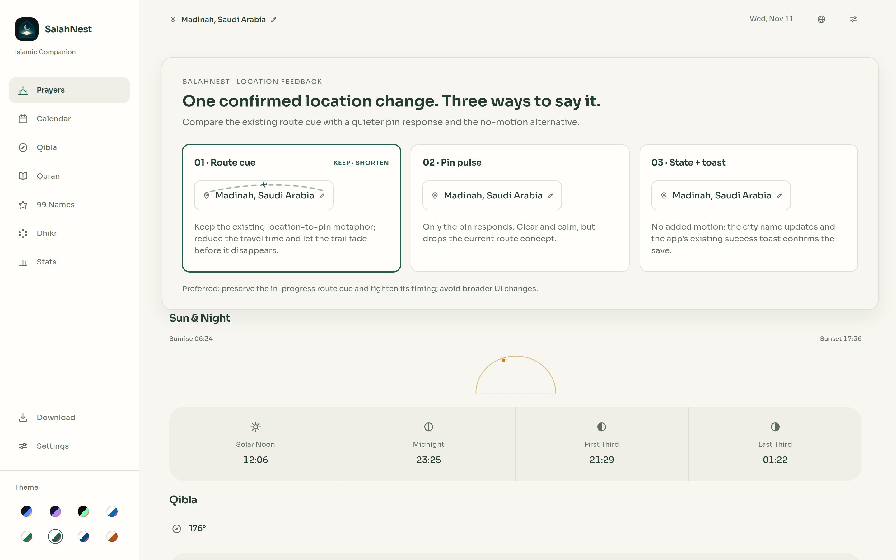

# SalahNest UI audit — 11 November 2026

## Result

The pass kept SalahNest’s approved direction: a dependable daily prayer timetable, with the next prayer easy to scan, the existing green/cream palette, logo, fonts, bilingual content, features, and behavior intact. I made focused improvements only: refined the in-progress location-arrival motion, filled Arabic gaps on the Stats screen, and nudged the Sahara accent one shade darker for readable small text. At review time, the changes were not yet committed or published; local `www` and `dist-web` builds were used for verification. `HEAD` was `ee4d6ee`.
**Design direction:** dependable prayer utility; calm, exact, warm; a readable timetable shaped by prayer time and location; the next prayer is the primary moment; the small route-to-pin location response is the signature. Concept: *keep the day’s prayer schedule immediately clear, and make a location change feel confirmed without delaying it.*

## What changed

- **Location confirmation:** kept the existing location-to-pin metaphor and refined its timing from 720ms to a named 480ms token. The plane and trail fade into the pin instead of disappearing abruptly; rapid repeat triggers do not restart a flight already in progress. RTL mirrors correctly. Reduced motion retains the same location result and confirmation without the travel animation.
- **Arabic Stats:** translated the existing headings, legend, note, per-prayer counts, and chart tooltips; no statistics or features were invented or removed.
- **Sahara contrast:** changed the primary accent from `#b45309` to `#b25209` and synchronized the theme-picker swatch. The measured contrast is now **4.56:1 on the page background** and **4.92:1 on the surface**, above the 4.5:1 text threshold.

The existing uncommitted location-animation work was preserved and refined, not reset. The three rendered feedback directions are shown here:

## Rendered review and verification

The final gallery contains 20 rendered route captures: ten routes in English/light desktop and ten in Arabic/RTL Midnight phone. The route report records **zero** horizontal overflow, console errors, page errors, or failed requests. The home-state matrix covers **160 combinations** (10 widths from 320px to 1920px × 8 themes × English/Arabic); all ten routes were additionally checked across **80 representative states** (two widths, two themes, both languages). No small location targets were found. Theme contrast checks range from 4.55:1 minimum for muted text to 4.56:1 minimum for the primary accent.

The location animation was captured at 60fps in four combinations: LTR/RTL and phone/desktop, 33 frames each. Contact sheets were reviewed; frame-difference measurements approach zero by the settled endpoint. Reduced-motion behavior was checked for both languages at phone and desktop sizes. `npm run www`, `npm run web`, `npm test`, and `git diff --check` all passed; the full test command includes the location-animation regression, 46 alert checks, and 13 UI-accessibility checks.

- [English desktop prayer home](./current-routes/en-islamic-desktop-1440/01-prayers.png)
- [Arabic RTL phone prayer home](./current-routes/ar-midnight-phone-390/01-prayers.png)
- [Desktop Qibla](./current-routes/en-islamic-desktop-1440/03-qibla.png) · [Desktop Stats](./current-routes/en-islamic-desktop-1440/07-stats.png) · [Desktop Calendar](./current-routes/en-islamic-desktop-1440/02-calendar.png)
- [English location-motion contact sheet](./motion-final/location-ltr-phone-390-light-sheet.png) · [Arabic RTL motion contact sheet](./motion-final/location-rtl-phone-390-dark-sheet.png)
- [Reduced-motion phone capture](./reduced-motion/390-light.png) · [Reduced-motion desktop capture](./reduced-motion/1440-light.png)
- [Sahara Quran screen, English](./theme-contrast/sahara-quran-390-en-light.png) · [Arabic](./theme-contrast/sahara-quran-390-ar-light.png)
- [20-screen route capture report](./current-routes/capture-report.json) · [Motion frame-difference measurements](./motion-final/frame-diff-metrics.json)

## Initial critique and approved follow-up

A fresh critic reviewed the final route gallery against Apple’s 2026 app-award calibration and scored it **7.3/10** (Inclusivity 8, Interaction 7, Visuals & Graphics 7): solid professional utility, not award-caliber yet. The mobile prayer timetable is the standout. The main remaining opportunities are the sparse desktop Qibla/Stats canvases (especially the no-history chart), weak calendar date hierarchy, and better lower-fold spacing on long phone pages. The earlier concern about inconsistent branding did not hold up against the completed route captures. The critique is a design judgment, not an Apple rating. Calibration source: [Apple Design Awards](https://developer.apple.com/design/awards/).

That critic recommended a bounded Qibla/Stats/Calendar composition pass and an explicit Stats empty state. The owner approved that exact follow-up. The detailed changes, fresh captures, verification, and new critique are below. Broader recommendations involving new Qibla sensor behavior, prayer data inside Calendar, or new Stats actions were not part of the approval and were not implemented.

## Approved composition follow-up

The pass remained within the approved three screens and necessary shared styling; it preserved the green/cream and Midnight themes, logo, typography, existing routes, and prayer-record behavior.

- **Qibla:** desktop now gives the compass a single, clearer focal card, with coordinates and the existing “How to use” guidance grouped beneath it. The 1024px desktop composition is vertically centered; phone layout remains stacked.
- **Calendar:** desktop month cells are larger and more legible inside a bounded calendar width; the phone grid and date navigation remain unchanged.
- **Stats:** the 30-day chart and per-prayer breakdown are paired on desktop and remain stacked on phones. With no records, the chart shows a truthful localized status message and hides the irrelevant legend; when records exist, the original 30-bar chart and legend still render. Existing headings and labels stay synchronized when the language changes while Stats is open.

The final capture set covers 3 screens at 390, 768, 1024, and 1440px in English/Islamic and Arabic/Midnight, under both OS color schemes (48 screenshots), plus two scrolled phone captures of the lower Stats panels. All capture logs are clean. The rendered matrix covers **480 states**: ten widths (320–1920px) × eight themes × two languages × three screens. It found zero clipping or horizontal overflow. Measured contrast minima were 4.55:1 for muted text, 4.56:1 for the primary accent, and 4.68:1 for the empty-state message on its card. Live English↔Arabic Stats switching, both empty and populated chart states (30 bars), and reduced motion were verified.

Builds and tests passed: `npm run www`, `npm run web`, `npm test` (all suites green, including 8 motion tests, 4 location-animation tests, 46 alert checks, and 13 UI-accessibility checks), and `git diff --check`. `HEAD` was `ee4d6ee` at review time; no commit or publication was part of that review.

The curated review bundle is this report, all linked screenshots, the compact 480-state composition matrix, and small verification summaries. The larger 160-state rendered matrix, full raw galleries, exploratory variants, and intermediate motion-frame sequences remain in the local review directory and are intentionally omitted from Git history.

- [Qibla, 1024px desktop](./composition-final/qibla-en-islamic/1024-light.png) · [Arabic RTL phone](./composition-final/qibla-ar-midnight/390-dark.png)
- [Calendar, 1440px desktop](./composition-final/calendar-en-islamic/1440-light.png) · [Arabic RTL phone](./composition-final/calendar-ar-midnight/390-dark.png)
- [Stats, 1440px desktop](./composition-final/stats-en-islamic/1440-light.png) · [English phone, empty chart and prayer breakdown](./composition-final/stats-detail-en-islamic/390-light.png) · [Arabic RTL phone](./composition-final/stats-detail-ar-midnight/390-dark.png)
- [480-state verification matrix](./composition-final/matrix.json)

A fresh critic scored the completed composition pass **6.7/10** (Inclusivity 7, Interaction 6, Visuals & Graphics 7): coherent and robust, but not award-caliber. The single most important remaining concern is that the prayer-timetable purpose is not the visual priority on these secondary screens. The critic also called out the icon-only desktop navigation, Calendar’s date-only cells, and the lack of a first-record action on empty Stats. Addressing those would require broader hierarchy or functionality decisions, so I stopped at the approved boundary; no sensor flow, prayer-time calendar data, navigation redesign, or new Stats action was added.

## Skills and limitations

Applied: `charles-unslop`, `charles-polish`, `charles-ux-animation`, and the available parts of `charles-unreasonable-craft`—including rendered three-way exploration, route/viewport/theme/language checks, frame-by-frame motion review, reduced-motion checks, and one final fresh critique. The `charles-unreasonable-craft` dependency `../interface-craft/SKILL.md` was not available in the repository or the accessible skill directories; I did not silently replace it with unrelated guidance.

Not applicable: `storage-cleanup` (Mac disk cleanup; no cleanup task), `claude-editing` and `arcade-motion` (video workflows; no footage/voiceover), and `accent-heroes` (landing-page artwork requiring a user reference screenshot that was not supplied). No artwork was generated. Live GPS, physical compass sensors, hardware touch behavior, screen-reader semantics, and keyboard behavior were not fully validated by this web-rendered audit.

## Source files changed

Across the initial audit and approved follow-up: `js/app.js`, `js/data.js`, `js/pages3.js`, `package.json`, `prayer-times.html`, `scripts/test-publish-readiness.js`, `scripts/test-location-animation.js` (existing uncommitted test, refined), `scripts/test-ui-accessibility.js`, `styles/app.css`, `styles/companion.css`, and `styles/motion.css`. The audit screenshots, matrices, and reports are under `docs/design-review/charles-audit-2026-11-11/`.
